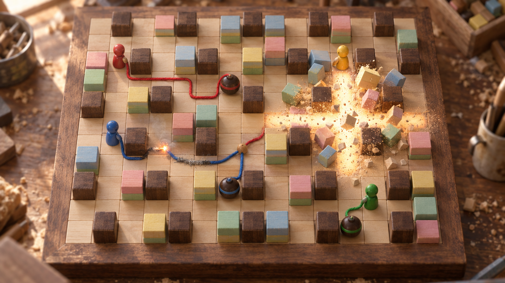

# MÈCHE, spécification de jeu

Titre de travail. Jeu d'arène versus pour navigateur desktop, de 2 à 4 joueurs, humains ou bots, sur un plateau de jouets en bois.



*Image de concept générée, pas un rendu du jeu.*

## 1. Le concept en une phrase

Un Bomberman où le compte à rebours n'est pas caché dans la bombe : c'est une ficelle que tu déroules derrière toi, que tu allumes quand tu veux, et que tout le monde voit brûler.

## 2. Fantasme du joueur

Je pose des pièges et je dessine leur minuterie sur le plateau. Je lis les ficelles des autres comme des horloges, et je peux allumer les leurs au moment qui m'arrange.

Mécaniquement, ça donne trois gestes :

- poser une bombe et décider où passe son délai ;
- décider quand ce délai démarre ;
- lire et détourner les délais des autres.

## 3. Rythme émotionnel d'une manche

`ouverture frénétique → je trace une mèche derrière un coin → j'attends → je vois une flamme courir vers moi → je calcule, je fuis → boum → « c'est TA bombe qui m'a eu, c'est moi qui l'ai allumée »`

Une manche dure de 2 à 3 minutes et un match se joue en 3 manches gagnantes, soit 10 à 15 minutes. On rejoue pour la revanche et pour tester une ruse vue chez un autre.

## 4. Principes de design

Ce sont les règles qui protègent l'identité du jeu. Quand une décision d'implémentation les contredit, ce sont elles qui gagnent.

1. **Aucun délai caché.** Une bombe n'explose que si un feu l'atteint ou si un souffle la touche. Chaque menace a une longueur visible sur le plateau.
2. **Toute bombe est tenue ou allumée.** À tout instant, chaque bombe est soit au bout d'une ficelle tenue par un joueur vivant, soit sur une ficelle qui brûle. Deux exceptions, liées à une arène : la mine de la Flaque (§12.3) et le pétard neutre des Dominos (§12.2), qui n'appartient à personne et attend sa ligne.
3. **Un seul bouton.** Il pose si tu ne tiens rien et allume si tu tiens une ficelle.
4. **Tout ce qui brûle obéit aux mêmes lois.** Les ficelles des joueurs, la poudre de la bordure, les dominos et la lampe du train suivent la même propagation (§7).
5. **Lisible en une seconde.** Pour chaque bombe à l'écran, un spectateur doit dire en une seconde à qui elle est et à peu près quand elle saute.
6. **Une mort se comprend.** Chaque élimination montre la chaîne qui l'a causée.
7. **Explosions de jouet.** Du bois, de la sciure, des cubes qui volent. Pas de feu réaliste, pas de sang.

## 5. Boucle de jeu

```text
poser ──▶ dérouler (marcher) ──▶ allumer ──▶ le feu court ──▶ BOUM
  ▲                                   │                          │
  │                         (ou : un autre allume ma ficelle)    │
  └──── se repositionner ◀── le plateau change (caisses, objets) ◀┘

en parallèle, en continu : lire les ficelles et les flammes des autres → fuir, attendre, ou détourner
```

| | |
|---|---|
| Verbe principal | poser / allumer (le même bouton) |
| Verbe secondaire | se déplacer, ce qui déroule et rembobine la ficelle |
| Réponse du système | le feu suit la ficelle à vitesse fixe et passe d'une ficelle à l'autre là où elles se touchent |
| Retour | flamme visible, grésillement qui monte dans l'aigu à l'approche de la bombe, bombe qui tremble |
| Récompense | caisse détruite, objet révélé, adversaire éliminé, détournement réussi |
| Décision créée | par où je fais passer ma ficelle, combien je la laisse longue, quand j'allume, laquelle des leurs j'allume |

## 6. Contrôles

| | Clavier J1 | Clavier J2 | Manette |
|---|---|---|---|
| Déplacement | ZQSD / WASD (selon la disposition détectée) | flèches | croix directionnelle ou stick gauche |
| Action | Espace | Entrée / Maj droite | A (Croix) |
| Pause | Échap | Échap | Start |

- Déplacement continu sur des couloirs de grille, comme dans Bomberman. On ne s'arrête pas entre deux cases.
- Aide aux virages : si on demande une direction perpendiculaire alors qu'on est à moins de 40 % d'une case d'un croisement, le personnage glisse dans le couloir. Sans ça, une grille au clavier est pénible.
- De 1 à 4 humains en local : deux au clavier, les autres à la manette. Les bots complètent jusqu'à 4.
- Pas de second bouton d'action. Aucune règle ne doit en réclamer un.

## 7. Lois du monde

Ce sont les cinq lois du jeu. Tout le reste (objets, arènes, mort subite) se contente de les réutiliser.

### L1. Poser

| | |
|---|---|
| Entrée | Action, sans ficelle tenue, avec au moins une bombe disponible |
| Changement d'état | une bombe apparaît sur ta case, une ficelle part d'elle et tu en tiens le bout |
| Visible | la bombe tombe et rebondit une fois, une pelote apparaît dans la main de la poupée |
| Usage | ouvrir des caisses, piéger, menacer |
| Cas limites | case déjà occupée par une bombe : rien ne se passe. Plus de bombe disponible : petit « clac » sec, rien ne se passe. |

Une bombe bloque le passage comme dans Bomberman. Les joueurs qui se trouvaient sur sa case au moment de la pose peuvent la quitter. Ensuite, seul celui qui tient sa ficelle peut y revenir (pour rembobiner jusqu'à la bombe).

### L2. Dérouler et rembobiner

| | |
|---|---|
| Condition | tu tiens une ficelle et tu entres dans une nouvelle case |
| Changement d'état | la case s'ajoute au chemin de la ficelle. Si la case est celle d'où tu venais juste avant, la dernière case est retirée (rembobinage). |
| Visible | la ficelle se pose au sol case par case. La pelote rétrécit et clignote à deux cases de la longueur max. |
| Usage | tracer le délai, contourner un coin, corriger une erreur en revenant sur tes pas |
| Longueur max | atteinte, la ficelle s'allume toute seule à ta main (L3). |
| Cas limites | entrer dans une case où ta propre ficelle passe déjà (sans être la précédente) crée un **nœud** : la case figure deux fois dans le chemin, ce qui raccourcit le trajet du feu (L4). Rembobiner jusqu'à la bombe : longueur 0, tu tiens toujours. |

Les ficelles ne bloquent personne : on marche dessus librement.

### L3. Allumer

| | |
|---|---|
| Entrée | Action pendant que tu tiens une ficelle |
| Changement d'état | un feu naît sur la case de ta main et tu lâches la ficelle. Tu peux reposer une bombe à l'appui suivant. |
| Visible | geste d'allumette, étincelle, « scritch-fwoosh » |
| Allumages automatiques | longueur max atteinte ; mort du porteur (la ficelle s'allume à sa main) ; un feu qui arrive à ta main par la ficelle (tu lâches, sans dommage) ; marcher dans une case en feu (ta ficelle s'y pose, donc la touche). |

### L4. Le feu court

| | |
|---|---|
| Règle | un feu avance le long d'une ficelle à vitesse fixe, dans toutes les directions qu'elle offre. La ficelle brûlée disparaît. |
| Contact | deux ficelles se **touchent** quand elles occupent la même case. Un feu qui atteint une case allume toutes les ficelles présentes sur cette case, la même ficelle à un autre endroit de son chemin (nœud) comme celles des autres. |
| Case de la bombe | arrivé sur la case de la bombe, le feu met 0,6 s à la traverser, puis la bombe saute. |
| Visible | étincelle orange vif et filet de fumée, trace de cendre grise pendant 1 s. Un nœud traversé fait sauter une petite étincelle d'une ficelle à l'autre, avec un « tic ». |
| Dégâts | aucun : le feu d'une ficelle ne blesse personne. |
| Deux feux qui se rencontrent | ils s'arrêtent tous les deux, il n'y a plus rien à brûler entre eux. |

Le feu prend donc toujours tous les chemins à la fois. Le temps avant l'explosion est le plus court chemin de ficelle entre la flamme la plus proche et la bombe, divisé par la vitesse, plus 0,6 s.

### L5. Boum

| | |
|---|---|
| Déclencheur | un feu finit de traverser la case de la bombe, ou un souffle touche la bombe |
| Souffle | une croix de portée R depuis la bombe, létale pendant 0,5 s |
| Arrêts | un mur arrête le souffle avant sa case. Une caisse l'arrête sur sa case et est détruite. Une bombe l'arrête et saute aussitôt (réaction en chaîne). |
| Effets | les joueurs dans la croix sont éliminés. Les objets au sol sont détruits, le souffle continue. Toute ficelle touchée s'allume à cet endroit (L4). La poudre de bordure chargée aussi (§8.5). |
| Visible | éclair de lumière chaude sur les cases, la seule zone blanc-orangé du jeu, puis sciure et cubes qui volent. Le décor ne bouge que pour l'effet : rien de cette physique n'influence la simulation. |

## 8. Mécaniques

### 8.1 Le détournement

Détourner, c'est allumer la ficelle de quelqu'un d'autre, avec un souffle qui la touche ou avec une ficelle à soi qui la croise. C'est le cœur du jeu : une ficelle tenue te laisse choisir le moment, mais n'importe qui peut le choisir à ta place.

D'où les décisions de chaque instant : une ficelle longue, donc exposée, ou courte, donc sans marge ; un trajet qu'aucun souffle adverse ne croisera ; ou au contraire s'approcher de la ficelle d'un autre pour la croiser avec la sienne.

Le coup de maître : allumer la ficelle d'un adversaire en son milieu pendant qu'il est encore près de sa bombe. Le feu part dans les deux sens, sa bombe saute plus tôt que prévu et il lâche sa ficelle.

### 8.2 Tenir

Tenir une ficelle, c'est garder la main sur le moment de l'explosion. Ça a un prix : tant que tu tiens, tu ne poses pas d'autre bombe, et ta ficelle reste exposée.

Tenir ne permet pas de tuer par surprise : quand tu allumes, la victime voit la flamme et dispose du temps de la ficelle. Tenir sert à contrôler une zone et à forcer l'autre à bouger.

### 8.3 Le nœud sur soi-même

Faire une boucle et repasser sur sa propre ficelle crée un raccourci : le feu saute au nœud et arrive plus tôt. C'est une découverte de niveau intermédiaire, que la règle L4 produit sans aucun ajout.

### 8.4 Objets

Les objets sortent des caisses (probabilité de 35 %, tirage déterministe par graine). On les ramasse en marchant dessus. Un souffle les détruit.

| Objet | Effet | Plafond |
|---|---|---|
| Bombe + | +1 bombe simultanée | 6 |
| Souffle + | portée +1 | 8 |
| Pelote + | longueur max de ficelle +2 cases | 14 |
| Patins | vitesse +0,5 case/s | 6 cases/s |

Il n'y a pas d'objet malus, pas de coup de pied et pas de gant : leur rôle (déplacer une menace, varier les manches) est déjà tenu par les ficelles.

### 8.5 La grande mèche (mort subite)

C'est une gorge creusée dans le plateau, anneau par anneau, de l'extérieur vers le centre. Elle suit L4 et L5 comme une ficelle.

1. À 1:15, la poudre coule dans l'anneau extérieur, visible et audible comme un sablier. L'anneau est alors chargé.
2. À 1:30, il s'allume tout seul à un point de départ tiré par la graine et indiqué dès le début de la manche par une allumette posée sur le cadre.
3. Entre 1:15 et 1:30, tout souffle ou feu qui touche une case chargée l'allume plus tôt, à cet endroit et dans les deux sens.
4. Le feu de la grande mèche avance à 5 cases/s. Sur chaque case qu'il quitte tombe un bloc de bois : il écrase un joueur, fait sauter une bombe, allume une ficelle et détruit un objet.
5. Quand un anneau est consumé, l'anneau suivant se charge en 2 s puis s'allume au même angle. Ça continue jusqu'au centre.
6. Les cases de mur traversées par un anneau ne reçoivent pas de bloc ; le feu passe dessous.

La poudre n'est chargée qu'à 1:15, parce que les spawns sont sur l'anneau extérieur : chargée dès le départ, la première bombe de la manche lancerait la fermeture.

### 8.6 Les éliminés : l'allumette

Une poupée éliminée devient une allumette qui se déplace sur le cadre, à l'extérieur du plateau.

- Action : elle lance une étincelle droit vers l'intérieur, sur sa ligne ou sa colonne, jusqu'à 4 cases. L'étincelle allume la première ficelle ou la première case de poudre chargée qu'elle touche. Elle ne fait rien d'autre.
- Recharge : 6 s.
- But : un éliminé reste dans la partie sans pouvoir tuer directement. Il n'utilise que L4.

## 9. Matrice d'interactions

| A | B | Résultat |
|---|---|---|
| Souffle | ficelle (quelle qu'elle soit) | allumée à cette case, feu dans les deux sens |
| Souffle | bombe | elle saute aussitôt, le souffle s'arrête là ; si sa ficelle était tenue, le porteur la lâche |
| Souffle | joueur | éliminé |
| Souffle | caisse | détruite, objet possible, le souffle s'arrête |
| Souffle | objet | détruit, le souffle continue |
| Souffle | poudre chargée | grande mèche allumée à ce point |
| Feu | nœud ou croisement | passe sur toutes les ficelles de la case |
| Feu | main du porteur | il lâche, sans dommage |
| Feu | joueur | rien |
| Feu | bombe | 0,6 s, puis boum |
| Joueur | sa ficelle, case précédente | rembobinage |
| Joueur | sa ficelle, case plus ancienne | nœud, raccourci |
| Joueur | case en feu | sa ficelle tenue s'allume à sa main |
| Porteur | mort | sa ficelle s'allume à sa main |
| Grande mèche | case quittée | bloc qui tombe : écrase, fait sauter, allume, détruit |
| Domino (§12.2) | souffle | chute en cascade, ouvre le passage, pétard au bout |
| Flaque (§12.3) | ficelle | la partie mouillée ne brûle pas, le feu s'arrête |
| Train (§12.4) | ficelle | la lampe du dernier wagon l'allume au passage |
| Train | joueur | renversé, éliminé |
| Allumette | ficelle ou poudre au bord | allumée |

## 10. Progression

C'est un jeu versus : il n'y a pas d'expérience ni d'arbre de talents. La progression, c'est la compréhension du joueur, et les arènes déplacent le sens des mêmes lois.

| Étape | Ce que le joueur comprend | Ce qui le provoque |
|---|---|---|
| 1 | la bombe ne part pas toute seule, c'est moi qui allume | premier appui dans le lobby-bac à sable |
| 2 | une ficelle longue derrière un coin me met à l'abri | une mort par ficelle trop courte |
| 3 | ma ficelle peut être allumée par un autre | le premier détournement subi, souvent par accident |
| 4 | les ficelles qui se croisent se transmettent le feu | un bot Moyen le fait devant lui |
| 5 | tenir contrôle une zone, mais m'expose | une ficelle tenue détournée |
| 6 | une boucle raccourcit ma propre ficelle | accident, puis usage volontaire |
| 7 | la bordure est une mèche, je peux lancer la fermeture | un souffle près du bord entre 1:15 et 1:30 |
| 8 | le décor a ses propres mèches | Dominos |
| 9 | l'eau coupe le feu : elle protège une ficelle ou fabrique une mine | Flaque |
| 10 | le passage du train est une horloge qui allume | Train |

Dans un match, la tension monte d'elle-même : plus de bombes et de portée grâce aux objets, puis la grande mèche réduit l'espace.

## 11. Structure

- Lobby-bac à sable, « l'Atelier » : un plateau de 9×7 où chaque joueur qui appuie sur un bouton apparaît et joue tout de suite. Les caisses repoussent, un mannequin de bois réapparaît, on y meurt sans conséquence et on revient au bout d'1 s. Pour être prêt, on va se placer sur son tapis de couleur. Les réglages (bots, arène, manches) sont dans un panneau à côté du plateau.
- Match : arène choisie ou aléatoire, 3 manches gagnantes.
- Manche : 2 à 4 poupées dans les coins, caisses symétriques, grande mèche à 1:15 et 1:30.
- Fin de manche : le résultat est décidé 1,5 s après qu'il ne reste qu'un joueur vivant (ou aucun). Si le dernier meurt dans cette fenêtre, la manche est nulle. Une manche nulle ne rapporte de point à personne.
- Fin de match : podium de poupées, revanche en un bouton.

Les manches se jouent sur un intérieur de 13×11 cases, entouré d'un cadre de murs. Les piliers sont posés sur les coordonnées paires. Les caisses sont placées par graine, avec une symétrie en miroir sur 4 quarts et une densité de 65 %. Chaque spawn garde libres son coin et les deux cases voisines.

## 12. Arènes représentatives

### 12.1 L'Établi : arène de base

```text
###############
#1.=========.2#
#.o=o=o=o=o=o.#
#==.=======.==#
#=o=o.o=o.o=o=#
#=.===.=.===.=#
#=o.o=o.o=o.o=#
#=.===.=.===.=#
#=o=o.o=o.o=o=#
#==.=======.==#
#.o=o=o=o=o=o.#
#3.=========.4#
###############
# cadre   o pilier   = caisse (exemple de tirage)   1-4 spawns
```

| | |
|---|---|
| Départ | sol intact, couloirs fermés par les caisses |
| Ce que croit le joueur | « c'est Bomberman » |
| Premier essai | il pose, s'éloigne, ne se passe rien, il appuie : la flamme part de ses pieds |
| Découverte | il tient le délai. Une ficelle autour d'un pilier le met à l'abri. |
| Interaction marquante | le souffle d'un voisin traverse sa ficelle tenue, sa bombe saute pendant qu'il est à côté |
| Surprise | la flamme saute d'une ficelle à une autre au croisement |
| Test de maîtrise | gagner une manche contre 3 bots Moyen |
| Ce qu'il sait ensuite | ses ficelles sont des horloges publiques, celles des autres sont des leviers |

### 12.2 Les Dominos

| | |
|---|---|
| Nouvel élément | des lignes de dominos debout. Elles bloquent le passage et sont des mèches neutres infranchissables : un souffle les fait tomber en cascade (6 cases/s, dans les deux sens). Les cases tombées deviennent du sol. Certaines lignes finissent sur un pétard neutre (portée 3). |
| Croyance de départ | « ce sont des murs » |
| Premier essai | un souffle touche une ligne par hasard, la cascade ouvre un raccourci |
| Découverte | on peut ouvrir un passage au moment choisi, et le pétard au bout est une bombe qui n'appartient à personne |
| Interaction | le pétard allume une ficelle qui passe à côté : chaînes à trois étages (domino → pétard → ficelle → bombe) |
| Maîtrise | attirer un adversaire au bout d'une ligne, puis la déclencher de loin |
| Mise en place | 4 lignes de 5 à 7 dominos, symétriques, deux finissent sur un pétard près du centre |

Les ficelles ne peuvent pas passer sur une case de domino (elle est bloquée). Seuls les souffles déclenchent les dominos.

### 12.3 La Flaque

| | |
|---|---|
| Nouvel élément | des flaques d'eau, sur lesquelles on marche. Une ficelle posée dans une flaque est mouillée : le feu n'entre pas sur ces cases et ne les traverse pas. Un souffle n'y allume rien. |
| Croyance de départ | « c'est du décor » |
| Premier essai | il allume, le feu s'arrête au bord de l'eau, la bombe ne saute pas |
| Découverte | côté bombe, la ficelle n'est plus reliée à rien : c'est une **mine**, qui attend un souffle ou un autre feu |
| Exception assumée au principe 2 | une mine n'est ni tenue ni allumée. Elle se repère par sa ficelle qui finit dans l'eau, plus sombre. Elle compte dans tes bombes simultanées tant qu'elle n'a pas sauté, ce qui limite le minage. |
| Usage inverse | faire passer sa ficelle tenue par l'eau la protège des détournements venus de ce côté |
| Maîtrise | poser une mine sur le chemin d'un adversaire, puis l'allumer à distance en croisant sa ficelle avec la mienne |

### 12.4 Le Train

| | |
|---|---|
| Nouvel élément | un train en bois (locomotive et deux wagons, 3 cases) qui boucle sans arrêt à 3 cases/s sur des rails, sur lesquels on marche. Il renverse les joueurs (élimination). La lampe du dernier wagon allume toute ficelle sur les cases qu'il traverse. Une bombe sur les rails saute au passage. Le train arrête les souffles et rien ne le détruit. |
| Signal | sifflet et phare 1,5 s avant qu'il entre dans une ligne droite visible |
| Croyance de départ | « c'est un obstacle » |
| Découverte | une ficelle posée en travers des rails s'allumera au passage du train : c'est un allumage à retardement, sans appuyer |
| Interaction | le train coupe aussi les plans : il allume les ficelles tenues qui traversent les rails |
| Maîtrise | faire allumer sa bombe par le train pendant qu'on est déjà loin et qu'on tient une autre ficelle |

## 13. Difficulté et apprentissage

- L'apprentissage se fait dans le lobby-bac à sable, sans texte. Seule aide contextuelle : si un joueur tient une ficelle depuis 3 s sans bouger, le bout de sa ficelle pulse avec le pictogramme du bouton Action.
- Les bots ont trois niveaux, et ils jouent avec les mêmes entrées que les humains (pas de déplacement magique). Ils lisent l'état complet du jeu, comme un humain qui voit tout le plateau.

| Niveau | Comportement |
|---|---|
| Facile | ouvre les caisses, s'éloigne d'au moins 3 cases hors de la croix avant d'allumer, fuit les dangers prévus, réagit avec 300 ms de retard, ne détourne jamais |
| Moyen | cible aussi les joueurs ; tient sa ficelle jusqu'à ce qu'un adversaire passe à 3 cases de sa bombe ; détourne quand son souffle croise une ficelle adverse dont la bombe est près d'un adversaire ; réagit avec 150 ms de retard |
| Malin | croise volontairement les ficelles adverses ; lance la grande mèche quand il est au centre ; se sert des nœuds ; tend des appâts |

- Pour décider, chaque bot calcule une **carte du temps** : pour chaque case, le temps avant qu'un souffle l'atteigne (plus court chemin de ficelle entre chaque feu et sa bombe, plus 0,6 s), et une menace « immédiate + longueur » pour les ficelles tenues. Les règles le rendent calculable exactement, il n'y a pas d'aléa.
- Les bots sont nécessaires dès le premier prototype : le jeu sera d'abord testé en solo.

## 14. Échec et reprise

- Échec : élimination de la manche (souffle, bloc de la grande mèche, train).
- Pendant l'élimination : l'éliminé devient une allumette (§8.6).
- Reprise : chaque manche repart d'un plateau neuf. Les objets ne passent pas d'une manche à l'autre.
- Rien n'est perdu au-delà de la manche : pas de progression à perdre, pas de compte.

## 15. Surprises et découvertes

| Moment | Le modèle mental change | Type |
|---|---|---|
| Premier appui | « je contrôle le délai » | mécanique |
| Premier détournement subi | « ma ficelle est une faiblesse » | systémique |
| Feu qui saute à un croisement | « les ficelles forment un réseau » | systémique |
| Boucle sur soi-même | « le feu prend le plus court chemin » | règle |
| Poudre dans la bordure | « l'arène est une mèche comme les autres » | échelle |
| Dominos | « le décor a ses propres mèches » | spatial |
| Flaque | « l'eau fabrique des mines » | inversion |
| Train | « une horloge mobile qui allume » | systémique |
| Allumette | « mort, j'agis encore » | perspective |

Le rythme : familiarité (Établi), variation (nœuds, tenue), maîtrise, rupture (grande mèche lancée par un joueur), nouveau modèle (arènes).

## 16. Monde

Une boîte de jouets en bois posée sur l'établi d'un artisan. Les poupées-quilles jouent aux artificiers. Il n'y a pas de récit. Quatre poupées : Rouge, Bleu, Jaune, Vert. Le monde ne sert qu'à justifier les matières (bois, ficelle, poudre, eau, train de bois) et les sons.

## 17. Direction artistique

Matière : jouet en bois, avec un aspect de photo de miniature (tilt-shift), mais seulement en dehors du plateau : le plateau reste net en entier.

C'est l'une des quatre directions proposées au départ, et la moins lisible d'emblée : du bois sur du bois. Les règles ci-dessous sont là pour corriger ça.

### Valeurs et couleurs

| Élément | Traitement |
|---|---|
| Sol | érable pâle, valeur claire, grain discret |
| Piliers | noyer foncé, plus hauts que les caisses : le contraste de valeur avec le sol est obligatoire |
| Caisses | cubes empilés peints en pastel mat, distincts par leur peinture et leur forme empilée |
| Poupées | laque saturée (rouge, bleu, jaune, vert) |
| Ficelles | coton de la couleur du joueur, épaisseur lisible de loin |
| Bombes | boule de bois sombre polie, cerclée de la couleur du poseur |
| Objets | jetons de bois clair, pictogramme peint en noir |
| Feu, souffle | les seules sources de lumière émissive du jeu, blanc-orangé |

- Réservé : les couleurs saturées sont réservées aux joueurs et à ce qui leur appartient (poupée, ficelle, cerclage de bombe). La lumière émissive est réservée au danger.
- Daltonisme : chaque joueur a aussi une forme et un motif. Rouge porte un chapeau pointu et une ficelle lisse, Bleu une casquette plate et une ficelle torsadée, Jaune un bouton rond et une ficelle à pois, Vert un anneau et une ficelle tressée.
- Lumière : jour chaud venu d'une fenêtre à gauche, ombres courtes. Quand la poudre entre (1:15), la lumière baisse vers le soir, ce qui fait ressortir les feux et marque le temps qui passe.
- Densité : le plateau doit garder des respirations. Pas de décor sur le sol des cases jouables.

## 18. Animation et mouvement

- Les poupées n'ont pas de jambes : elles avancent par petits sauts, un rebond par case.
- Une ficelle se pose avec un léger retard derrière la poupée, comme une vraie ficelle.
- Une bombe dont le feu arrive à 1 case puis traverse sa case tremble de plus en plus fort pendant les 0,6 s.
- Explosion : 2 images de lumière pleine, puis les cubes de caisse volent et retombent hors plateau. C'est une physique cosmétique, hors simulation.
- Élimination : la poupée est renversée, tournoie et sort du plateau.
- Gel à la mort : 0,4 s de gel, puis la chaîne causale s'éclaire 1 s (§21).

## 19. Son et musique

Le son porte de l'information d'état :

| Événement | Son | Information |
|---|---|---|
| Déroulement | ronronnement de pelote, petit clic par case | compter la longueur sans regarder |
| Pelote presque vide | cliquetis de bobine | « elle va s'allumer seule » |
| Allumage | craquement d'allumette | qui vient d'allumer |
| Feu sur ficelle | grésillement qui monte dans l'aigu à mesure que la bombe approche | le temps restant, à l'oreille |
| Nœud traversé | « tic » et petite étincelle | le feu vient de changer de ficelle |
| Explosion | « POK » de jouet et chute de cubes, plus grave quand la portée est plus grande | la puissance |
| Objet | arpège de marimba, différent pour chaque objet | lequel |
| Poudre qui coule | sablier | la fermeture approche |
| Bloc qui tombe | « tchok » lourd de bois | case perdue |
| Train | tchou-tchou en bois et sifflet | sa position |
| Élimination | choc de quille et sifflement descendant | qui |

Musique : instruments en bois (marimba, wood-block, kalimba, contrebasse pizzicato), autour de 100 BPM. Une couche de percussions s'ajoute quand la poudre entre, et le tempo monte d'environ 5 % à chaque anneau consumé.

## 20. Caméra

Tout le plateau reste à l'écran par défaut : perspective légère, plongée d'environ 58°. Le joueur peut tourner autour du plateau (glisser à la souris, molette pour zoomer, touches de rotation, stick droit) dans des limites qui gardent toujours le plateau lisible : pas de vue rasante, pas de vue sous le plateau, pas de déplacement latéral. Une touche remet la vue par défaut.

Les commandes suivent la caméra : « haut » envoie la poupée vers le fond de l'écran, avec l'orientation de la caméra arrondie au quart de tour le plus proche, pour que la grille reste jouable pendant qu'on tourne.

Pas de tremblement d'écran : à chaque explosion, une pulsation de zoom de 1 % au plus. Rien ne doit gêner la lecture des ficelles.

## 21. Interface

- Bandeau en haut : quatre têtes de poupée, chacune avec 3 perles de victoire et ses objets en petits jetons. Une petite horloge au centre, que la poudre remplace visuellement à partir de 1:15.
- Chaîne causale à la mort : pendant 1 s, le chemin qui a tué s'éclaire d'un liseré blanc (ficelle(s), nœuds, souffle), et le point d'allumage porte une étoile de la couleur de celui qui l'a allumé. C'est ce qui enseigne les détournements. Aucun texte.
- Écrans : titre (le couvercle de la boîte, « MÈCHE » pyrogravé), lobby-bac à sable, pause, fin de manche (2 s), fin de match (podium), réglages (touches, volume, assignation des manettes).
- Le texte se limite aux menus et aux réglages. Il n'apparaît jamais en partie.

## 22. Persistance

En `localStorage` : réglages, touches, dernière configuration du lobby, statistiques locales simples (manches gagnées, détournements réussis). Pas de compte et pas de serveur.

## 23. Rejouabilité

On rejoue pour les arènes, les tirages de caisses et d'objets, les trois niveaux de bots et les revanches. Ce qu'on s'attend à voir les joueurs inventer :

- dessiner des formes avec les ficelles (cœurs, initiales), un comportement qui se partage ;
- appâter avec une ficelle tenue bien visible ;
- des « guerres de croisement » autour d'un couloir ;
- des défis qu'on se donne (gagner sans tenir, gagner seulement par détournement).

Plus tard, et à garder ouvert : la simulation étant déterministe, une manche se résume à une graine et des entrées, ce qui permet de partager un replay par lien (comme Cabin 37).

## 24. Contraintes techniques qui touchent au design

- Navigateur desktop récent (Chrome, Firefox, Safari), WebGL 2, Three.js. 60 images/s sur un portable à GPU intégré en 1080p.
- Entrées : clavier partagé à deux et Gamepad API pour 4 manettes.
- Simulation déterministe, séparée du rendu : pas de temps fixe à 60 Hz, positions en virgule fixe ou entiers, graine pour tout l'aléa. Les débris qui volent sont cosmétiques. C'est ce qui permettra d'ajouter plus tard le jeu en ligne (hôte qui fait autorité ou lockstep) sans réécrire le jeu. Une règle de gameplay qui dépendrait du moteur physique est interdite.
- Assets générés en code (géométrie, textures de bois procédurales), comme les autres jeux du profil. Sons synthétisés ou générés hors ligne.
- Hébergement : GitHub Pages, en fichiers statiques.
- Pas de réseau dans le périmètre actuel (§27).

## 25. Contenu à produire

- 4 arènes : Établi, Dominos, Flaque, Train, plus l'Atelier (lobby).
- 4 poupées (couleur, chapeau, motif de ficelle), une bombe, une ficelle (posée, tenue, brûlante, cendre, mouillée), un nœud, un feu, un souffle.
- Piliers, caisses (en variantes de pastel), 4 objets, poudre de bordure (vide, chargée, en feu), bloc qui tombe, dominos, pétard, flaques, rails, train.
- Le mannequin de l'Atelier et les tapis « prêt ».
- Les écrans du §21.
- Les sons du §19, plus 2 pistes : lobby, et match avec sa couche de fermeture.
- Les bots, en trois niveaux.

## 26. Cas limites

- Deux joueurs qui entrent dans la même case au même pas de temps : les deux ficelles s'y posent, ce qui fait un croisement.
- Un feu et un souffle qui atteignent la même bombe au même pas : une seule explosion.
- Un porteur qui rembobine jusqu'à la bombe puis allume : 0,6 s, et il est sur la case de la bombe.
- Double appui immédiat : bombe à 0,6 s. On ne s'en échappe qu'en diagonale de 2 cases depuis un croisement (0,5 s à 4 cases/s). C'est une prise de risque volontaire.
- Ficelle tenue qui touche une case de poudre chargée qui prend feu : la ficelle s'allume à cette case, dans les deux sens.
- Bloc de la grande mèche qui tombe sur une case de ficelle tenue : la ficelle s'allume là (le feu y est passé).
- Manette déconnectée : pause automatique.
- Tous les joueurs sont des bots : interdit, il faut au moins un humain. Un mode spectateur pour régler l'équilibrage est un outil de développement, pas une fonction du jeu.
- Une mine (Flaque) dont le poseur est éliminé reste en place.
- Objet sous une ficelle : on le ramasse normalement, la ficelle reste.

## 27. Questions ouvertes et risques

```text
OPEN QUESTION : les deux appuis sont-ils naturels ?
Réponses possibles : A. un bouton, poser puis allumer (actuel) / B. maintenir pour dérouler, relâcher pour allumer / C. allumage auto au bout de N cases
Pourquoi c'est important : c'est le premier contact et le plus gros risque du concept.
Penchant actuel : A (on peut tenir sans rien maintenir, et on a un seul geste).
Ce qui tranchera : le prototype gris ; voir §29.
```

```text
OPEN QUESTION : calibrage du feu
Réponses possibles : 2 / 2,5 / 3 cases/s
Pourquoi c'est important : trop lent, rien ne tue ; trop rapide, on retombe sur un délai caché.
Penchant actuel : 2,5 cases/s, soit environ 3 s pour 6 cases, l'équivalent des 3 s classiques.
Ce qui tranchera : la proportion de morts « comprises » contre « injustes » dans les tests.
```

```text
OPEN QUESTION : jeu en ligne
Réponses possibles : P2P sur GitHub Pages + relais TURN de secours / P2P strict / serveur WebSocket
Pourquoi c'est important : c'est reporté, mais ça impose dès maintenant la simulation déterministe (§24).
Penchant actuel : P2P avec un relais TURN Cloudflare de secours, quand le jeu sera bon en local.
```

```text
OPEN QUESTION : nom définitif
« Mèche » marche en français, beaucoup moins à l'international. À trancher avant la publication.
```

Risques :

1. Les deux appuis (voir plus haut).
2. Lisibilité à 4 : quatre ficelles tenues et plusieurs feux sur du bois. Parades : couleur et motif réservés, ficelles épaisses, longueur max à 6 au départ.
3. Compétence des bots : planifier une ficelle est plus dur que poser une bombe. Avec des bots faibles, les tests solo ne disent rien du jeu.
4. Repli sur le jeu classique : si les joueurs font surtout des doubles appuis, la ficelle n'apporte rien.
5. Grande mèche : elle doit se lire aussi bien qu'une spirale de blocs classique. Repli possible : les blocs tombent en spirale, sans poudre.
6. Contraste du bois (§17).

## 28. Plan de prototype

Le plus petit prototype qui prouve ou réfute le concept :

- Établi en formes primitives : cubes, sphères, ficelles en lignes de couleur épaisses.
- 1 humain contre 1 à 3 bots Facile.
- Les lois L1 à L5, sans objets, sans grande mèche. Au bout de 2:30, la manche est nulle.
- Grésillement qui monte dans l'aigu et chaîne causale à la mort : on les met dès ce stade, parce qu'ils sont indispensables pour juger la lisibilité.

Jalons, dans l'ordre :

1. Prototype gris (ci-dessus).
2. Lisibilité et sensation : ficelles, feu, souffle, sons principaux, aide aux virages.
3. Versus local complet : 2 à 4 humains, objets, manches et match, grande mèche, Atelier, bots Moyen.
4. Direction artistique bois complète, musique.
5. Arènes Dominos, Flaque, Train, bots Malin, allumettes.
6. Plus tard : jeu en ligne.

## 29. Critères de validation

```text
PASS : un nouveau joueur, avec seulement « flèches + Espace », pose, s'éloigne et allume dans sa première minute, sans lire de texte.
FAIL : il attend que la bombe saute toute seule, ou se fait sauter en double-appui plus de 2 fois.

PASS : contre des bots Moyen, un joueur subit un détournement dans ses 3 premières manches, et explique ensuite pourquoi sa bombe a sauté plus tôt.
FAIL : il ne sait pas dire ce qui s'est passé malgré la chaîne causale.

PASS : avant la 5e manche, le joueur trace volontairement une ficelle autour d'un coin.
FAIL : plus de 70 % de ses bombes sont allumées à moins de 2 cases (on est revenu au jeu classique).

PASS : sur une capture d'écran à 4 joueurs, un observateur dit en 1 s, pour chaque bombe, à qui elle est et dans combien de temps elle saute (à ±1 s près).
FAIL : il hésite sur le propriétaire ou confond une ficelle tenue avec une ficelle qui brûle.

PASS : la majorité des morts sont jugées « méritées » par le joueur qui meurt.
```

## 30. Contrat d'implémentation

L'agent qui implémente ne doit pas réinterpréter ces règles :

1. Un seul bouton d'action : il pose si l'on ne tient rien, il allume si l'on tient une ficelle.
2. Une bombe n'a **aucun minuteur interne**. Elle saute quand un feu a traversé sa case (0,6 s) ou quand un souffle la touche.
3. Toute bombe est tenue par un vivant ou allumée. La mort du porteur allume sa ficelle à la main. Seules exceptions : la mine de la Flaque et le pétard neutre des Dominos.
4. Les ficelles occupent des cases. Deux ficelles se touchent quand elles partagent une case, et le feu passe au contact, y compris sur la même ficelle (nœud).
5. Revenir sur la case précédente rembobine. Entrer dans une case plus ancienne de sa ficelle crée un nœud.
6. Le feu d'une ficelle ne blesse personne. Seuls tuent les souffles, les blocs de la grande mèche et le train.
7. Les ficelles ne bloquent pas le déplacement. Les bombes le bloquent.
8. La grande mèche, les dominos et la lampe du train obéissent à la même propagation que les ficelles.
9. La simulation est déterministe, en pas de temps fixe et pilotée par les entrées. La physique cosmétique n'y entre jamais.
10. Aucun texte en partie. L'apprentissage passe par l'Atelier, le pictogramme du bouton et la chaîne causale.
11. Les couleurs saturées appartiennent aux joueurs, la lumière émissive au danger.

### Valeurs de départ (à régler au prototype)

| Paramètre | Départ | Raison |
|---|---|---|
| Marche | 4 cases/s | proche de Bomberman |
| Feu sur ficelle | 2,5 cases/s | moins vite que la marche : on a le temps de fuir une flamme qu'on voit |
| Traversée de la case bombe | 0,6 s | durée minimale d'une bombe, double-appui jouable mais risqué |
| Longueur max | 6 cases (+2 par Pelote, max 14) | 6 cases ≈ 3 s, comme le classique |
| Bombes simultanées | 1 (max 6) | classique |
| Portée | 2 (max 8) | classique |
| Souffle létal | 0,5 s | classique |
| Patins | +0,5 case/s (max 6) | |
| Poudre chargée, puis allumée | 1:15, puis 1:30 | |
| Feu de la grande mèche | 5 cases/s | on s'écarte, on ne la double pas |
| Recharge entre anneaux | 2 s | |
| Fenêtre de résultat | 1,5 s | |
| Manches gagnantes | 3 | |
| Allumette | portée 4, recharge 6 s | |
| Objet dans une caisse | 35 % | |
| Train | 3 cases/s, sifflet 1,5 s avant | |
| Dominos | 6 cases/s | |
