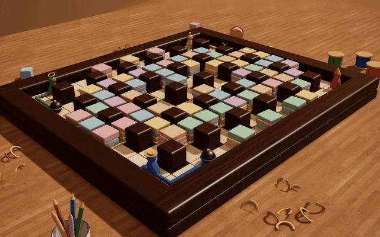
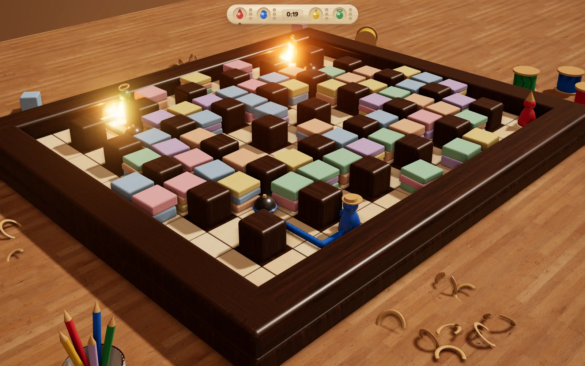
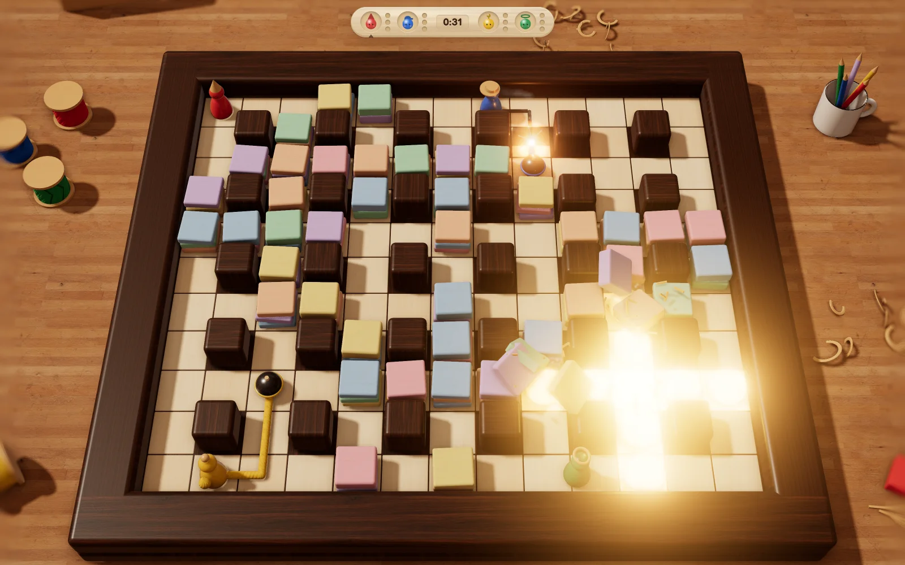

# MÈCHE

> Le compte à rebours, c'est toi qui le dessines.

Un jeu d'arène à la Bomberman, sur un plateau de jouets en bois. Ici, ta bombe ne part pas toute seule au bout de trois secondes. Tu la poses, elle reste attachée à une ficelle qui se déroule derrière toi quand tu marches, et c'est toi qui allumes, quand tu veux. Le feu remonte la ficelle jusqu'à la bombe, et tout le monde le voit courir.

La ficelle est aussi ton point faible. Un souffle qui la touche l'allume à cet endroit, et deux ficelles qui passent sur la même case se transmettent le feu. Tu peux faire sauter la bombe d'un adversaire pendant qu'il est encore à côté.

**Jouer : https://sderosiaux.github.io/meche/**

Navigateur de bureau récent (WebGL 2), au clavier ou à la manette. Le son compte : le grésillement monte dans l'aigu quand une bombe va sauter.







## Comment on joue

| | Clavier | Manette |
|---|---|---|
| Se déplacer | ZQSD (ou WASD) ou flèches | croix ou stick gauche |
| Poser, puis allumer | Espace | A |
| Tourner la vue | A / E en AZERTY (Q / E en QWERTY), ou glisser à la souris | stick droit, LB / RB |
| Zoomer | molette | |
| Recentrer la vue | R ou double-clic | R3 |
| Pause | Échap | Start |
| Couper le son | M | |

Un appui pose la bombe, le suivant allume ta ficelle. Revenir sur tes pas la rembobine. Si elle atteint sa longueur maximale (6 cases), elle s'allume toute seule. Une bombe n'a pas de minuterie cachée : elle saute quand le feu l'atteint ou quand un souffle la touche. Le feu d'une ficelle ne blesse personne, seuls les souffles tuent.

Les commandes suivent la caméra : « haut » envoie toujours ta poupée vers le fond de l'écran, même quand tu as tourné autour du plateau.

On joue seul contre 1 à 3 bots, en Facile ou en Moyen. Le premier à trois manches gagne le match. À chaque élimination, le jeu montre pendant une seconde le chemin du feu qui a tué, avec une étoile de la couleur de celui qui l'a allumé. C'est comme ça qu'on apprend les détournements.

## Lancer en local

Il faut Node 22 et pnpm.

```sh
pnpm install
pnpm dev      # http://localhost:5190
```

L'URL accepte quelques paramètres : `bots=1..3`, `level=facile|moyen`, `seed=<nombre>` pour rejouer la même partie, `autostart=1` pour sauter le menu, `debug=1` pour le panneau de debug (F1 le masque). F2 change la qualité graphique.

## Développer

```sh
pnpm typecheck
pnpm test
pnpm build                       # dist/ statique, chemins relatifs
pnpm bots --rounds 200 --levels moyen,moyen,facile,facile
```

`pnpm bots` fait jouer des manches entre bots, sans affichage, et sort des statistiques : durée des manches, morts par sa propre bombe, détournements, longueur de ficelle à l'allumage. C'est le garde-fou quand on touche aux règles ou aux bots.

Chaque push sur `main` reconstruit le jeu et le publie sur GitHub Pages (`.github/workflows/pages.yml`).

## Comment c'est fait

TypeScript, Three.js et Vite. La simulation est séparée du rendu : 60 pas par seconde, uniquement des entiers, et tout le hasard vient d'une graine. Une partie se rejoue donc à l'identique à partir de sa graine et des touches pressées. C'est ce qui permettra d'ajouter le jeu en ligne sans tout réécrire.

Les médias ont tous été générés pour le jeu :

- les effets sonores avec ElevenLabs, les trois musiques (menu, partie, tension) avec Lyria. `node scripts/audio/generate.mjs` les régénère, il lui faut `ELEVENLABS_API_KEY` et `GEMINI_API_KEY` ;
- les textures de bois et le panorama de l'atelier avec GPT Image, puis rendus raccordables par `scripts/textures/process.py` ;
- l'image de concept de départ est dans [`art/concepts/`](art/concepts/).

Les règles complètes, le pourquoi des choix et la suite prévue sont dans [`GAME_SPEC.md`](GAME_SPEC.md).

## Où en est le jeu

C'est un prototype jouable : une arène, les règles de base, des bots, la direction artistique et le son. Pas encore là : les objets à ramasser, la grande mèche qui referme l'arène, les arènes Dominos, Flaque et Train, le salon d'entraînement, le multijoueur local à plusieurs humains et le jeu en ligne entre navigateurs.
